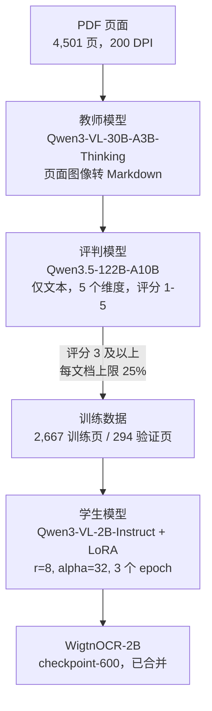

<div align="center">


<br>

[](#动态)
[](requirements.txt)
[](LICENSE)
[](https://huggingface.co/Wigtn/Qwen3-VL-2B-WigtnOCR)
[](https://huggingface.co/datasets/Wigtn/KoGovDoc-Bench)

[English](README.md) | [한국어](README.ko.md) | [中文](README.cn.md)

</div>

# WigtnOCR

**面向结构保留文档解析的伪标签蒸馏**

> 将 30B VLM 的文档解析能力蒸馏到 2B 模型中，再检验其结构化输出是否有助于韩国政府文档上的检索。

## 动态

- **2026-10-25** · 以 WigtnOCR-2B 作为生产解析器的后续研究 RCPS 在 **EMNLP 2026 (Industry Track)** 上报告：线上报告，10 月 25 日（周日）12:30–14:00 CET，Virtual Session 1（[会议日程](https://2026.emnlp.org/program/)）。
- **2026-08** · *Retrieval-Conditional Parsing Score (RCPS): Choosing Document Parsers by Retrieval, Not by Appearance* 被 **EMNLP 2026 Industry Track** 录用。通讯作者：Hyeong-seob Kim。[论文（camera-ready PDF）](https://github.com/wigtn/WigtnOCR-RADP/blob/main/output/pdf/EMNLP2026_Industry_384_camera_ready_final.pdf) · [代码](https://github.com/wigtn/WigtnOCR-RADP) · [适配器](https://github.com/wigtn/RCPS-RADP-Adapters)
- **2026-03** · [WigtnOCR-2B](https://huggingface.co/Wigtn/Qwen3-VL-2B-WigtnOCR) 和 [KoGovDoc-Bench](https://huggingface.co/datasets/Wigtn/KoGovDoc-Bench) 已在 Hugging Face 发布。

> **同一条研究主线，分布在三个仓库中。**
> 1. **wigtnOCR-v1**（本仓库）：把 Qwen3-VL-30B 蒸馏为 2B 的 Qwen3-VL 解析器。
> 2. **[WigtnOCR-RADP](https://github.com/wigtn/WigtnOCR-RADP)**：RCPS 论文，以该解析器为起点，依据检索效果选择解析器。
> 3. **[RCPS-RADP-Adapters](https://github.com/wigtn/RCPS-RADP-Adapters)**：论文中解析器训练研究所用的九个 LoRA 适配器。

WigtnOCR 使用经评判模型筛选的伪标签和 LoRA 微调，将文档解析能力从 Qwen3-VL-30B（教师模型）蒸馏到 Qwen3-VL-2B（学生模型）。在 OmniDocBench 上，得到的 **WigtnOCR-2B** 在 5 项指标中的 3 项（Text NED、Table TEDS、Reading Order）上达到或超过其 30B 教师模型。在 v1 KoGovDoc 检索评估中，它在六个解析器中的 Hit@1、Hit@5 和 MRR@10 均排名第一，该评估的查询取自它自身的输出（见下文）；在 RCPS 论文的问答 probe 上，它与 30B 教师模型持平。

---

## 基于 Qwen 构建

训练流程中的每个模型都是公开发布的 Qwen 模型。WigtnOCR 是 WIGTN 的独立项目，并非 Qwen 官方发布。



| 角色 | 模型 | 用途 |
|---|---|---|
| 教师模型 | Qwen3-VL-30B-A3B-Thinking | 为每张页面图像生成 Markdown。vLLM 0.13.0，2 个 GPU，temperature 0.1 |
| 评判模型 | Qwen3.5-122B-A10B（NVFP4 版本） | 仅依据 Markdown 在五个维度上打分；低于 3 分的页面被剔除（[评分标准](docs/pseudo-label-judge.md)） |
| 学生模型 | Qwen3-VL-2B-Instruct | 在语言模型上做 LoRA，视觉编码器和 merger 保持冻结。ms-swift 4.0.1，DeepSpeed ZeRO-2 |
| 困惑度模型，v1 BC/CS | Qwen2.5-1.5B-Instruct | 在 v1 KoGovDoc 评估中计算 Boundary Clarity 和 Chunk Stickiness |
| RCPS 论文中的检索器 | Qwen3-Embedding-8B | RCPS 取平均的三个检索器之一，另外两个是 BGE-M3 和 multilingual-e5-large |
| 困惑度模型，RCPS 论文 | Qwen3-VL-2B-Instruct | 在 RCPS 论文中计算 Boundary Clarity |

分步操作流程见 [docs/qwen3-vl-lora-guide.md](docs/qwen3-vl-lora-guide.md)（[한국어](docs/qwen3-vl-lora-guide.ko.md)）。

---

## 从 WigtnOCR 到 RCPS

<strong>v1 评估的发现。</strong>在 KoGovDoc 上，微调后的模型与另外五个解析器进行了比较（见下方表格）。其中有一个结果与其余结果不一致：

- 在全部六个解析器中，MinerU 的分块边界得分最好（BC 0.735，CS 2.711）。
- 但它在检索上排在六个中的第五位（Hit@1 0.608）。

仅依据解析器输出计算的指标，并不能判断检索器搭配哪个解析器效果最好。

<strong>RCPS 论文检验的内容。</strong>这篇 EMNLP 2026 论文把 WigtnOCR-2B 作为生产解析器，论文中称之为 *Prod*。论文在一个冻结的 probe 上重新进行比较：663 个问答对，覆盖在 WigtnOCR 训练中留出的 294 个验证页面。论文报告了以下结果：

- **内在指标可能给出错误的解析器排序。**
  - 启用表格处理的 MinerU-on 的 Boundary Clarity 高于 Prod（0.713 vs 0.610），但其 Hit@1 低 42.6 个点（0.123 vs 0.549）。
  - 在 BC 有定义的四个完整输出上，BC 与 RCPS 的 Pearson 相关系数为 r = −0.74。
- <strong>RCPS 依据检索效果对解析器排序。</strong>RCPS 是在三个检索器和 k ∈ {1, 5, 10} 上取平均的 mean reciprocal rank。
  - 五个完整的解析器输出的取值范围为 0.137 到 0.584。
  - 30B 教师模型（0.584）与 Prod（0.583）几乎并列第一。
- **Coverage 区分解析器造成的损失与分块器造成的损失。**
  - 对于 Prod，有 20.2% 的参考答案在分块前的解析器输出中没有归一化后的精确匹配。
  - 所有测试过的分块器切分的比例都不超过 2.3%。
- <strong>在这里，选择比调优更重要。</strong>在同样的 294 页上，微调使 Prod 的 Hit@1 比 2B 基座高 4.9 个点。选择 Prod 而不是 MinerU-on，会使 Hit@1 变化 42.6 个点。
- **在 Prod 基础上进行面向检索的训练，带来的变化很小。**
  - 在一个经审计的 OHR-Bench 子集上，两个 DPO 检查点的 Hit@5 仅分别提升 0.95 和 1.15 个点。
  - 匹配的编辑距离对照表现相近。

论文最终给出的工作流程是：用 RCPS 选择，用 coverage 诊断，仅在必要时训练解析器。

<div align="center">

</div>

下方的 v1 表格与上方的 RCPS 数值来自不同的评估协议。它们使用的查询集、相关性规则和检索器都不同，因此不能直接比较。

---

## 主要结果（v1 评估）

### OmniDocBench：蒸馏效果

<div align="center">

</div>

| 模型 | Text NED ↓ | Table TEDS ↑ | CDM F1 ↑ | Read Order ↓ | Skip % ↓ |
|-------|:----------:|:------------:|:--------:|:------------:|:--------:|
| Qwen3-VL-2B（基座） | 0.364 | 0.561 | 0.865 | 0.300 | 18.8% |
| **WigtnOCR-2B（本项目）** | **0.288** | **0.649** | **0.884** | **0.211** | **5.8%** |
| Qwen3-VL-30B（教师模型） | 0.289 | 0.523 | 0.939 | 0.227 | 5.5% |
| Marker | 0.218 | 0.586 | 0.863 | 0.165 | 0.4% |

<strong>WigtnOCR-2B 在 5 项指标中的 3 项上达到或超过其 30B 教师模型：Text NED、Table TEDS 和 Reading Order。</strong>教师模型在 CDM F1（0.939 vs 0.884）和 Skip %（5.5% vs 5.8%）上仍然领先。Table TEDS 比教师模型高 +12.6pp，跳过率从 18.8%（基座）降至 5.8%。Skip % 指 1,355 个页面中没有可用输出的页面所占的比例。30B 一行使用 Qwen3-VL-30B-A3B-Instruct-FP8 评估；伪标签则来自 Thinking 版本。

### KoGovDoc：检索性能

<div align="center">

</div>

| 模型 | Hit@1 ↑ | Hit@5 ↑ | MRR@10 ↑ | nDCG@10 ↑ |
|-------|:-------:|:-------:|:--------:|:---------:|
| **WigtnOCR-2B** | **0.739** | **0.855** | **0.788** | 0.437 |
| Qwen3-VL-30B | 0.716 | 0.839 | 0.771 | 0.411 |
| Marker | 0.711 | 0.853 | 0.771 | 0.412 |
| Qwen3-VL-2B | 0.709 | 0.814 | 0.756 | **0.444** |
| MinerU | 0.608 | 0.789 | 0.682 | 0.384 |
| PaddleOCR | 0.512 | 0.693 | 0.592 | 0.293 |

在全部 6 个解析器中，**WigtnOCR-2B 在 Hit@1、Hit@5 和 MRR@10 上均排名第 1**；2B 基座在 nDCG@10 上领先。与 PaddleOCR（纯 OCR）相比，Hit@1 提升了 +22.7pp。

<strong>本表的测量方式。</strong>[`run_retrieval_eval.py`](scripts/eval_kogovdoc/run_retrieval_eval.py) 从 **WigtnOCR-2B 自身输出**的标题和首句中为每个文档最多选取 20 个查询（38 个文档共 564 个查询），并把查询所属文档的每个块都计为相关。从某一个解析器的输出中抽取的查询可能对该解析器有利。上文的 RCPS 论文则使用 663 个问答对，其答案逐字出现在参考页面上，并采用页面级相关性；在该协议下，30B 教师模型与 WigtnOCR-2B 几乎持平。

### BC/CS：分块质量不等于检索质量

<div align="center">

</div>

| 模型 | BC ↑ | CS ↓ |
|-------|:----:|:----:|
| MinerU | **0.735** | **2.711** |
| WigtnOCR-2B | 0.706 | 2.859 |
| Qwen3-VL-30B | 0.714 | 3.164 |
| Marker | 0.683 | 3.206 |
| Qwen3-VL-2B | 0.678 | 3.446 |
| PaddleOCR | 0.654 | 3.420 |

MinerU 在 BC/CS 上领先，但检索排名第 5，因此仅凭分块边界质量无法预测检索性能。RCPS 论文正是对这一结果做了后续研究（见上文）。

---

## 工作原理

### 蒸馏流程

```
Stage 1: Pseudo GT Generation
    PDF pages → Qwen3-VL-30B-A3B-Thinking (teacher) → Structured Markdown
    4,501 pages across 49 documents (Korean + English)

Stage 2: Quality Validation
    GT Markdown → Qwen3.5-122B-A10B (judge, text-only) → Score 1–5
    74–75% pass rate, 5-dimension quality scoring

Stage 3: Training Data Preparation
    Quality filtering (score ≥ 3) + bias correction + train/val split
    2,667 train / 294 val pages

Stage 4: LoRA Fine-tuning
    Qwen3-VL-2B-Instruct + LoRA (rank=8, alpha=32) → WigtnOCR-2B
    ms-swift, DeepSpeed ZeRO-2, 3 epochs, released checkpoint: step 600
```

### 两步评估（KoGovDoc）

```
Step 1: Does structured parsing produce better chunks?
    6 parsers × semantic chunking → BC/CS (perplexity-based, MoC ACL 2025)

Step 2: Do better chunks produce better retrieval?
    Chunks → BGE-M3 embedding → FAISS → Hit@K, MRR, nDCG
    Queries: headings and first sentences of WigtnOCR-2B outputs (564), document-level relevance
```

<strong>结果：</strong>在这些查询下，结构化 VLM 解析器的检索效果最好，但分块得分最好的解析器（MinerU）排在第五位。仅凭分块指标无法预测检索效果。

---

## 复现结果

生成上方各表的训练和评估代码都在本仓库中：`training/`、`evaluation/`、`scripts/` 和 `configs/`。需要三个环境，因为 vLLM 和 ms-swift 固定的库版本不同：

```bash
python -m venv .venv-train && .venv-train/bin/pip install -r requirements.txt        # ms-swift 4.0.1, torch 2.9.1
python -m venv .venv-serve && .venv-serve/bin/pip install -r requirements-serve.txt  # vLLM 0.13.0
python -m venv .venv-eval  && .venv-eval/bin/pip install -r requirements-eval.txt    # evaluation code + RCPS reference implementation
```

快速开始，每个脚本对应一个阶段（先启动对应的 `scripts/serve_*.sh`）：

```bash
bash scripts/01_pseudo_labels.sh      # teacher writes Markdown for every page
bash scripts/02_judge_filter.sh       # judge scores, filter, per-document cap, 90/10 split
bash scripts/03_train_lora.sh         # LoRA with configs/lora_qwen3vl2b_v1.yaml, merge checkpoint-600
bash scripts/04_eval_omnidocbench.sh  # OmniDocBench v1.5: Text NED, TEDS, Reading Order, CDM
bash scripts/05_eval_kogovdoc.sh      # KoGovDoc: Text NED; BC/CS and Hit@K/MRR/nDCG (v1); RCPS protocol
```

为这次发布，下表中的每项结果都通过在 v1 运行保存的输出上重新运行公开代码进行了核对。GPU 步骤（服务部署、训练、模型推理）没有重新运行。

| 结果 | 代码 | 核对 |
|---|---|---|
| 训练设置 | [`configs/lora_qwen3vl2b_v1.yaml`](configs/lora_qwen3vl2b_v1.yaml) | dry-run 的 `swift sft` 命令在每一个超参数上都与 v1 运行的 `args.json` 一致 |
| 评判筛选 | [`docs/pseudo-label-judge.md`](docs/pseudo-label-judge.md) | 筛选后的 arXiv 页面数（646）可以从 v1 评判报告中复现 |
| OmniDocBench：Text NED、TEDS、Reading Order、Skip % | `scripts/eval_omnidocbench/run_eval.py` | 0.288 / 0.649 / 0.211 / 79 页，在存档输出上完全一致 |
| OmniDocBench：CDM F1 | `scripts/eval_omnidocbench/run_cdm.py` | 未重新运行（需要 TeX 工具链） |
| KoGovDoc v1：Hit@K / MRR / nDCG | `scripts/eval_kogovdoc/run_retrieval_eval.py` | 能复现出同样的 564 个查询。换用不同的 BGE-M3 服务时，分数无法精确复现，因为语义分块边界会随嵌入而变化 |
| KoGovDoc v1：BC/CS | `scripts/eval_kogovdoc/run_bccs_eval.py` | 未重新运行（需要 Qwen2.5-1.5B-Instruct 困惑度服务） |
| RCPS 协议：检索 | `scripts/eval_kogovdoc/run_rcps_eval.py` | BGE-M3 子集与 RCPS 运行结果完全相同（Hit@1 0.5445，MRR@10 0.5928） |
| RCPS 协议：Boundary Clarity | WigtnOCR-RADP `compute_parser_bc.py` | 1,161 个边界上的平均 BC 为 0.6100；论文报告的值为 0.610 |

**v1 运行环境。**
- 硬件：2 × NVIDIA RTX PRO 6000 Blackwell Server Edition（每块 98 GB），128 GB RAM，CUDA 12.8。
- 软件：PyTorch 2.9.1，Transformers 4.57.3，ms-swift 4.0.1，vLLM 0.13.0（教师模型和学生模型；评判模型使用 nightly 版本）。
- 评判抽样、每文档上限、训练/验证划分以及训练（`seed`、`data_seed`）均使用 seed 42。
- 训练 1,002 步耗时 31 分 37 秒，每个 GPU 的峰值显存为 47.25 GiB。

本仓库未包含：49 个文档的源 PDF、训练集划分（`train.jsonl`）以及 `wigtnocr` 推理库。完整的操作说明（包括评估损失曲线以及选择 `checkpoint-600` 的原因）见 [docs/qwen3-vl-lora-guide.md](docs/qwen3-vl-lora-guide.md)。

---

## 训练数据集

| 数据集 | 文档数 | 页数 | 语言 | 来源 |
|---------|:---------:|:-----:|:--------:|--------|
| **KoGovDoc** | 10 | 3,637 | 韩语 | 政府出版物 |
| **ArXivPapers** | 39 | 864 | 英语 | arXiv（cs.CL, cs.CV, cs.LG） |
| **合计** | 49 | 4,501 | 双语 | |

GT 由 Qwen3-VL-30B-A3B-Thinking 生成，并由 Qwen3.5-122B-A10B 验证（仅文本的评判模型，5 个维度打分）。经过筛选和每文档上限处理后：2,667 个训练页面和 294 个验证页面。验证集划分已以 [KoGovDoc-Bench](https://huggingface.co/datasets/Wigtn/KoGovDoc-Bench) 的形式公开。

---

## 模型

模型权重可在 Hugging Face 获取：

- **[WigtnOCR-2B](https://huggingface.co/Wigtn/Qwen3-VL-2B-WigtnOCR)**：Qwen3-VL-2B-Instruct + LoRA，已合并。它是 v1 运行中的 `checkpoint-600`，即评估损失最低的那一步。

---

## 输出示例

在一个复杂的韩国政府文档页面上的对比（kogov_001 p.9：调查表格、统计图表以及混合版式）。

| | 30B 教师模型 | WigtnOCR-2B（本项目） |
|---|---|---|
| 图表 | `[Figure: ...]` 占位符 | 将数据提取为表格 |
| 内容 | 1,582 字符 | **1,912 字符（+21%）** |
| 表格 | 3 个表格 | **4 个表格**（图表 → 表格） |

<details>
<summary><b>PDF 原文</b></summary>


</details>

<details>
<summary><b>30B 教师模型输出（Qwen3-VL-30B）</b>：1,582 字符</summary>

```markdown
- 지역 주민 의견 및 수요

## [군민 설문조사] 군민 478명 대상 설문조사로 도시문제 도출
- 군민 대상 설문조사 사항

| No. | 설문 항목 |
|-----|-----------|
| Q1 | 성별 / 연령 / 지역 / 불편사항 |
| Q2 | 안전 / 환경 / 에너지 / 교통 / 산업 / 행정 / 복지 / 문화 / 관광 / 농업 / 교육 |
| Q3 | 스마트도시 요소 / 지역 / 서비스 / 리빙랩 |

### - 군민 설문결과

[Figure: 보다 안전한 부여를 위해 개선해야 할 문제]
[Figure: 스마트도시 우선도입 서비스]

자료 : 부여군 스마트도시계획(2023)

## [농어업인 복지실태조사] 생활안전 개선을 위해 필요한 사항 설문결과

| 특성 | 도로안전시설 | 보행자길 정비 | 가로등 확충 | CCTV 설치 | 주민 방범 순찰 | 노후시설 | 안심 귀가 서비스 | 기타 |
|------|-------------|-------------|------------|----------|--------------|---------|----------------|------|
| 농어촌 | 10.1 | 21.0 | 23.1 | 25.7 | 8.1 | 8.2 | 3.4 | 0.3 |
| 읍 | 10.7 | 20.8 | 20.5 | 28.1 | 8.4 | 7.2 | 4.2 | 0.1 |
| 면 | 9.5 | 21.2 | 25.8 | 23.3 | 7.8 | 9.3 | 2.7 | 0.4 |
| 농어가 | 8.7 | 22.3 | 23.2 | 23.1 | 7.9 | 12.1 | 2.5 | 0.2 |
| 비농어가 | 10.6 | 20.5 | 23.1 | 26.6 | 8.2 | 6.9 | 3.7 | 0.3 |
| 30대 이하 | 14.6 | 16.5 | 27.6 | 25.2 | 6.4 | 5.8 | 3.6 | 0.2 |
| 40대 | 6.3 | 20.1 | 19.6 | 33.1 | 10.9 | 4.6 | 5.1 | 0.2 |
| 50대 | 10.8 | 19.4 | 23.0 | 27.2 | 6.8 | 8.4 | 4.1 | 0.3 |
| 60대 | 10.5 | 22.9 | 22.8 | 23.4 | 7.2 | 10.2 | 2.6 | 0.4 |
| 70대 이상 | 9.9 | 23.5 | 24.0 | 21.1 | 8.7 | 10.4 | 2.2 | 0.2 |

자료 : 농촌진흥청 2023 농어업인등에 대한 복지실태조사

| 구분 | 도시문제 | 주민 수요 | 수요 주민 |
|------|----------|-----------|-----------|
| 복지 | 독거노인 돌봄 | - 부여군 보건복지 분야 개선사항으로 지적 | 70대 남성 |
| 복지 | 독거노인 돌봄 | - 인공지능 돌봄서비스 시범 사용 희망 | 60대 여성 |
| 복지 | 시설노후화 | - 부여군 읍면 경로당 내 시설 노후화 | 80대 남성 |
| 복지 | 여가 콘텐츠 부족 | - 경로당 내 여가 콘텐츠 부족 | 60대 여성 |
| 안전 | 안전 인프라 부족 | - 부여시장 근교 노인 보행자 교통사고 위험 높음 | 60대 남성 |
| 관광 | 관광 콘텐츠 부족 | - 수년 동안 업데이트되지 않은 박물관 내 콘텐츠 | 50대 남성 |
```

</details>

<details>
<summary><b>WigtnOCR-2B 输出（本项目）</b>：1,912 字符</summary>

```markdown
- 지역 주민 의견 및 수요

[균민 설문조사] 균민 478명 대상 설문조사로 도시문제 도출
- 균민 대상 설문조사 사항

| No. | 설문 항목 |
| --- | --- |
| Q1 | 성별 / 연령 / 지역 / 불편사항 |
| Q2 | 안전 / 환경 / 에너지 / 교통 / 산업 / 행정 / 보건 / 복지 / 문화 / 관광 / 농업 / 교육 |
| Q3 | 스마트도시 요소 / 지역 / 서비스 / 리빙랩 |

- 균민 설문결과

| 보다 안전한 부여를 위해 개선해야 할 문제 | 스마트도시 우선도입 서비스 |
| --- | --- |
| 시설 노후화 | 34.1% |
| 교통사고 다발구간 | 13.7% |
| 자연재해감시 | 12.8% |
| 심야시간 범죄 | 10.0% |
| 통학 안전 | 9.3% |
| 인재 | 8.2% |
| 재난 예경보 | 8.7% |
| 기타 | 3.4% |
| 스마트 보건/의료/복지 | 17.4% |
| 스마트 교통 | 15.7% |
| 스마트 환경/에너지/수자원 | 10.5% |
| 스마트 문화/관광/스포츠 | 10.1% |
| 스마트 근로/고용 | 9.9% |
| 스마트 행정 | 8.9% |
| 스마트 교육 | 7.6% |
| 스마트 방법/방재 | 6.4% |
| 스마트 시설물관리 | 4.5% |
| 스마트 주거 | 3.2% |
| 스마트 물류 | 2.8% |
| 기타 | 2.9% |

자료 : 부여군 스마트도시계획(2023)

[농어업인 복지실례조사] 생활안전 개선을 위해 필요한 사항 설문결과

| 특성 | 도로안전시설 | 보행자길 정비 | 가로등 확충 | CCTV 설치 | 주민 방법순찰 | 노후시설 | 안심 귀가 서비스 | 기타 |
| --- | --- | --- | --- | --- | --- | --- | --- | --- |
| 농어촌 | 10.1 | 21.0 | 23.1 | 25.7 | 8.1 | 8.2 | 3.4 | 0.3 |
| 읍 | 10.7 | 20.8 | 20.5 | 28.1 | 8.4 | 7.2 | 4.2 | 0.1 |
| 면 | 9.5 | 21.2 | 25.8 | 23.3 | 7.8 | 9.3 | 2.7 | 0.4 |
| 농어가 | 8.7 | 22.3 | 23.2 | 23.1 | 7.9 | 12.1 | 2.5 | 0.2 |
| 비농어가 | 10.6 | 20.5 | 23.1 | 26.6 | 8.2 | 6.9 | 3.7 | 0.3 |
| 30대 이하 | 14.6 | 16.5 | 27.6 | 25.2 | 6.4 | 5.8 | 3.6 | 0.2 |
| 40대 | 6.3 | 20.1 | 19.6 | 33.1 | 10.9 | 4.6 | 5.1 | 0.2 |
| 50대 | 10.8 | 19.4 | 23.0 | 27.2 | 6.8 | 8.4 | 4.1 | 0.3 |
| 60대 | 10.5 | 22.9 | 22.8 | 23.4 | 7.2 | 10.2 | 2.6 | 0.4 |
| 70대 이상 | 9.9 | 23.5 | 24.0 | 21.1 | 8.7 | 10.4 | 2.2 | 0.2 |

자료 : 농촌진흥청 2023 농어업인등에 대한 복지실례조사

| 구분 | 도시문제 | 주민 수요 | 수요 주민 |
| --- | --- | --- | --- |
| 복지 | 독거노인 돌봄 | - 부여군 보건복지 분야 개선사항으로 지적 | 70대 남성 |
| 복지 | 독거노인 돌봄 | - 인공지능 돌봄서비스 시범 사용 호평 | 60대 여성 |
| 복지 | 시설노후화 | - 부여군 읍면 경로당 내 시설 노후화 | 80대 남성 |
| 복지 | 여가 콘텐츠 부족 | - 경로당 내 여가 콘텐츠 부족 | 60대 여성 |
| 안전 | 안전 인프라 부족 | - 부여시장 근교 노인 보행자 교통사고 위험 높음 | 60대 남성 |
| 관광 | 관광 콘텐츠 부족 | - 수년 동안 업데이트되지 않은 박물관 내 콘텐츠 | 50대 남성 |
```

</details>

> <strong>主要区别：</strong>30B 教师模型用 `[Figure: ...]` 占位符代替图表，而 WigtnOCR-2B 将图表中的实际数据提取为结构化的 Markdown 表格，从同一页面中多产出 21% 的内容。

---

## 参考资料

- [Qwen3-VL](https://huggingface.co/Qwen/Qwen3-VL-2B-Instruct)：基础 VLM 系列（教师模型和学生模型）
- [Qwen3.5-122B-A10B](https://huggingface.co/Qwen/Qwen3.5-122B-A10B)：评判模型
- [ms-swift](https://github.com/modelscope/ms-swift)：ModelScope 微调框架，用于 LoRA 训练
- [MoC](https://arxiv.org/abs/2503.09600)：BC/CS 分块质量指标（ACL 2025）
- [OmniDocBench](https://github.com/opendatalab/OmniDocBench)：文档解析基准（CVPR 2025）
- [vLLM](https://github.com/vllm-project/vllm)：VLM 推理服务引擎
- [BGE-M3](https://huggingface.co/BAAI/bge-m3)：多语言嵌入模型
- [PaddleOCR](https://github.com/PaddlePaddle/PaddleOCR)：OCR 基线（经由 RapidOCR）
- [Marker](https://github.com/VikParuchuri/marker)：PDF 转 Markdown 工具
- [MinerU](https://github.com/opendatalab/MinerU)：PDF 解析工具

---

## 许可证

Apache License 2.0

## 引用

```bibtex
@software{wigtnocr2026,
  title   = {WigtnOCR: Pseudo-Label Distillation for Structure-Preserving Document Parsing},
  author  = {Kim, Hyeongseob},
  year    = {2026},
  url     = {https://github.com/wigtn/wigtnOCR-v1}
}

@inproceedings{son2026rcps,
  title     = {Retrieval-Conditional Parsing Score (RCPS): Choosing Document Parsers by Retrieval, Not by Appearance},
  author    = {Son, Sang-Woo and Kim, Hyeong-seob and Kim, Hyeonsang and Cho, Hyun-woo and Kim, Jinmo},
  booktitle = {Proceedings of EMNLP 2026 (Industry Track)},
  year      = {2026},
  note      = {Accepted}
}
```

---

## 🏢 About WIGTN Crew

本项目由 **[WIGTN Crew](https://wigtn.com)** 构建和维护，这是一个位于韩国的 AI 原生开源研究团队。我们开发实用的、面向特定领域的 AI 工具。快速做原型，扎实做工程，交付真实可用的产品。

| | |
|---|---|
| 🌐 网站 | [wigtn.com](https://wigtn.com) |
| 🐙 GitHub | [github.com/wigtn](https://github.com/wigtn) |
| 🤗 HuggingFace | [huggingface.co/Wigtn](https://huggingface.co/Wigtn) |
| 📦 NPM | [npmjs.com/org/wigtn](https://www.npmjs.com/org/wigtn) |

### 🔬 Our Projects

| 项目 | 简介 | 状态 |
|---------|-------------|--------|
| [WigtnOCR](https://huggingface.co/Wigtn/Qwen3-VL-2B-WigtnOCR) | 基于 VLM 的韩国政府文档解析器 | 研究中 |
| [WIGVO](https://wigtn.com) | 实时 PSTN 语音翻译（韩语↔英语） | 研究中 |
| [Claude Code Plugin](https://github.com/wigtn/wigtn-plugins) | 多智能体并行执行生态 | 开源 |

> 成果比履历更有说服力。
