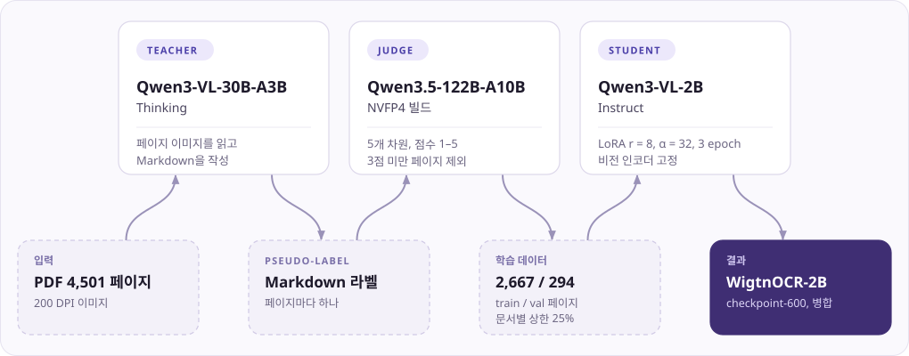
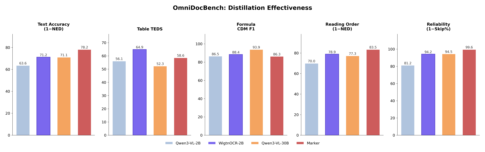
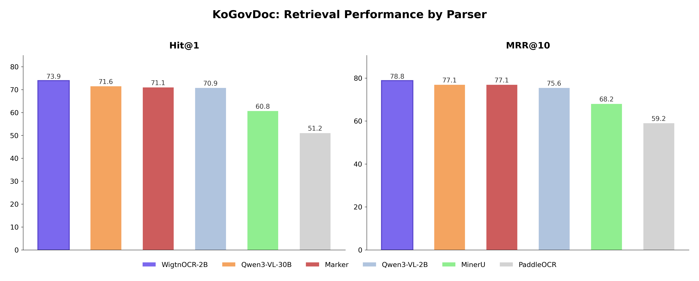
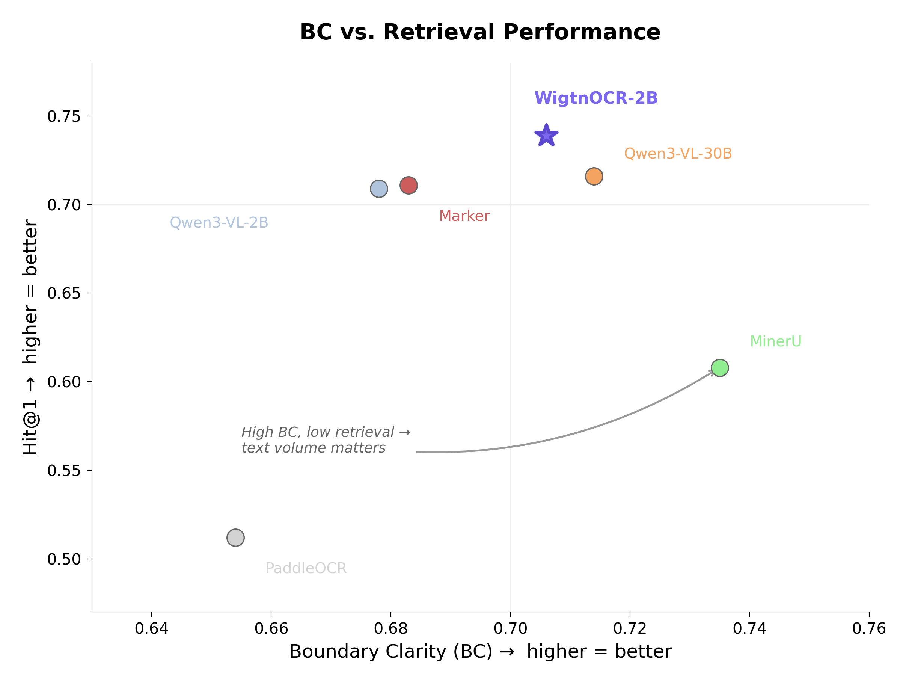
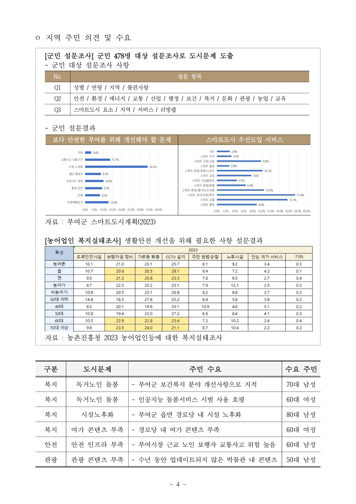

<div align="center">


<br>

[](requirements.txt)
[](LICENSE)
[](https://huggingface.co/Wigtn/Qwen3-VL-2B-WigtnOCR)
[](https://huggingface.co/datasets/Wigtn/KoGovDoc-Bench)

[English](README.md) | [한국어](README.ko.md) | [中文](README.cn.md)

</div>

# WigtnOCR

**Pseudo-Label Distillation 기반 구조 보존 문서 파싱**

> 30B VLM의 문서 파싱을 2B 모델로 증류한 뒤, 그 구조화된 출력이 한국 정부 문서 검색에 도움이 되는지 시험합니다.

## 소식

- **2026-10-25** · WigtnOCR-2B를 production 파서로 쓰는 후속 연구 RCPS를 <strong>EMNLP 2026 (Industry Track)</strong>에서 발표합니다: 온라인 발표, 10월 25일 일요일, 12:30–14:00 CET, Virtual Session 1 ([프로그램](https://2026.emnlp.org/program/)).
- **2026-08** · *Retrieval-Conditional Parsing Score (RCPS): Choosing Document Parsers by Retrieval, Not by Appearance* 논문이 **EMNLP 2026 Industry Track**에 채택되었습니다. 교신저자: Hyeong-seob Kim. [논문 (camera-ready PDF)](https://github.com/wigtn/WigtnOCR-RADP/blob/main/output/pdf/EMNLP2026_Industry_384_camera_ready_final.pdf) · [코드](https://github.com/wigtn/WigtnOCR-RADP) · [어댑터](https://github.com/wigtn/RCPS-RADP-Adapters)
- **2026-03** · [WigtnOCR-2B](https://huggingface.co/Wigtn/Qwen3-VL-2B-WigtnOCR)와 [KoGovDoc-Bench](https://huggingface.co/datasets/Wigtn/KoGovDoc-Bench)를 Hugging Face에 공개했습니다.

> **한 가지 연구 흐름이 세 저장소에 나뉘어 있습니다.**
> 1. **wigtnOCR-v1** (이 저장소): Qwen3-VL-30B를 2B Qwen3-VL 파서로 증류합니다.
> 2. **[WigtnOCR-RADP](https://github.com/wigtn/WigtnOCR-RADP)**: 그 파서에서 출발해 검색 결과로 파서를 고르는 RCPS 논문입니다.
> 3. **[RCPS-RADP-Adapters](https://github.com/wigtn/RCPS-RADP-Adapters)**: 논문의 파서 학습 실험에서 나온 LoRA 어댑터 아홉 개입니다.

WigtnOCR은 judge가 걸러 낸 pseudo-label과 LoRA fine-tuning으로 Qwen3-VL-30B(teacher)의 문서 파싱을 Qwen3-VL-2B(student)에 증류합니다. 그 결과로 나온 **WigtnOCR-2B**는 OmniDocBench의 지표 5개 중 3개(Text NED, Table TEDS, Reading Order)에서 30B teacher와 같거나 더 나은 결과를 냅니다. v1 KoGovDoc 검색 평가에서는 자신의 출력에서 뽑은 질의를 기준으로 Hit@1, Hit@5, MRR@10에서 파서 여섯 개 중 1위입니다(아래 참고). RCPS 논문의 질문–답변 프로브에서는 30B teacher와 같은 수준입니다.

---

## Qwen 기반

<div align="center">
<a href="https://github.com/QwenLM/Qwen3-VL"></a>
<br>
<sub>배너 출처: <a href="https://qwen.ai/blog?id=qwen3-vl">Qwen3-VL 발표 글</a></sub>
</div>

학습 파이프라인의 모든 모델은 공개된 Qwen 모델입니다. WigtnOCR은 WIGTN의 독립 프로젝트이며 Qwen 공식 릴리스가 아닙니다.

<p align="center">

</p>

| 역할 | 모델 | 사용 방식 |
|---|---|---|
| Teacher | Qwen3-VL-30B-A3B-Thinking | 모든 페이지 이미지의 Markdown을 작성합니다. vLLM 0.13.0, GPU 2개, temperature 0.1 |
| Judge | Qwen3.5-122B-A10B (NVFP4 빌드) | Markdown만 보고 다섯 개 차원으로 채점하고 3 미만인 페이지는 제외합니다 ([채점 기준](docs/pseudo-label-judge.md)) |
| Student | Qwen3-VL-2B-Instruct | 언어 모델에 LoRA를 적용하고 vision encoder와 merger는 고정합니다. ms-swift 4.0.1, DeepSpeed ZeRO-2 |
| Perplexity 모델, v1 BC/CS | Qwen2.5-1.5B-Instruct | v1 KoGovDoc 평가에서 Boundary Clarity와 Chunk Stickiness를 계산합니다 |
| RCPS 논문의 검색기 | Qwen3-Embedding-8B | RCPS가 평균을 내는 검색기 세 개 중 하나이며 나머지는 BGE-M3와 multilingual-e5-large입니다 |
| Perplexity 모델, RCPS 논문 | Qwen3-VL-2B-Instruct | RCPS 논문에서 Boundary Clarity를 계산합니다 |

단계별 절차는 [docs/qwen3-vl-lora-guide.ko.md](docs/qwen3-vl-lora-guide.ko.md)에 있습니다 ([English](docs/qwen3-vl-lora-guide.md)).

---

## WigtnOCR에서 RCPS로

**v1 평가에서 드러난 것.** fine-tuning한 모델을 KoGovDoc에서 다른 파서 다섯 개와 비교했습니다(아래 표). 결과 하나가 들어맞지 않았습니다:

- MinerU는 파서 여섯 개 가운데 청크 경계 점수가 가장 좋았습니다(BC 0.735, CS 2.711).
- 그런데 검색에서는 여섯 개 중 5위였습니다(Hit@1 0.608).

파서 출력만으로 계산한 지표로는 검색기가 어느 파서의 출력에서 가장 좋은 결과를 낼지 알 수 없었습니다.

**RCPS 논문이 시험한 것.** EMNLP 2026 논문은 WigtnOCR-2B를 production 파서로 사용하고 이를 *Prod*라고 부릅니다. 논문은 고정된 프로브 위에서 비교를 다시 구성합니다: WigtnOCR 학습에서 제외해 둔 검증 페이지 294개에 대한 질문–답변 쌍 663개입니다. 논문이 보고하는 내용은 다음과 같습니다:

- **내재 점수는 파서 순위를 잘못 매길 수 있습니다.**
  - 표 처리를 켠 MinerU-on은 Prod보다 Boundary Clarity가 높지만(0.713 vs 0.610) Hit@1은 42.6포인트 낮습니다(0.123 vs 0.549).
  - BC가 정의되는 완전한 출력 네 개에서 BC와 RCPS의 Pearson 상관계수는 r = −0.74입니다.
- **RCPS는 검색 결과로 파서 순위를 매깁니다.** RCPS는 검색기 세 개와 k ∈ {1, 5, 10}에 대해 평균한 mean reciprocal rank입니다.
  - 완전한 파서 출력 다섯 개가 0.137부터 0.584까지 걸쳐 있습니다.
  - 30B teacher(0.584)와 Prod(0.583)는 맨 위에서 근소한 동률입니다.
- **Coverage는 파서 손실과 청커 손실을 구분합니다.**
  - Prod의 경우 참조 답변의 20.2%는 청킹 전 파서 출력에 정규화 후 정확히 일치하는 부분이 없습니다.
  - 시험한 청커 중 2.3%를 넘게 분할하는 것은 없습니다.
- **여기서는 튜닝보다 선택이 더 중요합니다.** 같은 294 페이지에서 fine-tuning은 Prod의 Hit@1을 2B base보다 4.9포인트 높였습니다. MinerU-on 대신 Prod를 고르면 Hit@1이 42.6포인트 달라집니다.
- **Prod 위에 검색을 고려한 학습을 더해도 변화는 작았습니다.**
  - 검수를 거친 OHR-Bench 부분집합에서 DPO 체크포인트 두 개는 Hit@5를 각각 0.95, 1.15포인트만 높입니다.
  - 조건을 맞춘 edit-distance 대조군도 비슷한 성능을 보입니다.

논문이 마지막에 제시하는 작업 흐름은 다음과 같습니다: RCPS로 고르고 coverage로 진단한 뒤 필요할 때만 파서를 학습합니다.

<div align="center">

</div>

아래 v1 표와 위의 RCPS 수치는 서로 다른 프로토콜에서 나왔습니다. 질의 세트, 관련성 규칙, 검색기가 다르므로 직접 비교할 수 없습니다.

---

## 주요 결과 (v1 평가)

### OmniDocBench: 증류 효과

<div align="center">

</div>

| 모델 | Text NED ↓ | Table TEDS ↑ | CDM F1 ↑ | Read Order ↓ | Skip % ↓ |
|-------|:----------:|:------------:|:--------:|:------------:|:--------:|
| Qwen3-VL-2B (Base) | 0.364 | 0.561 | 0.865 | 0.300 | 18.8% |
| **WigtnOCR-2B (Ours)** | **0.288** | **0.649** | **0.884** | **0.211** | **5.8%** |
| Qwen3-VL-30B (Teacher) | 0.289 | 0.523 | 0.939 | 0.227 | 5.5% |
| Marker | 0.218 | 0.586 | 0.863 | 0.165 | 0.4% |

**WigtnOCR-2B는 지표 5개 중 3개에서 30B teacher와 같거나 앞섭니다: Text NED, Table TEDS, Reading Order.** CDM F1(0.939 vs 0.884)과 Skip %(5.5% vs 5.8%)에서는 teacher가 앞섭니다. Table TEDS는 teacher보다 +12.6pp 높고 skip rate는 18.8%(base)에서 5.8%로 떨어집니다. Skip %는 1,355 페이지 중 쓸 수 있는 출력이 없는 페이지의 비율입니다. 30B 행은 Qwen3-VL-30B-A3B-Instruct-FP8로 평가했습니다. pseudo-label은 Thinking 버전에서 나왔습니다.

### KoGovDoc: 검색 성능

<div align="center">

</div>

| 모델 | Hit@1 ↑ | Hit@5 ↑ | MRR@10 ↑ | nDCG@10 ↑ |
|-------|:-------:|:-------:|:--------:|:---------:|
| **WigtnOCR-2B** | **0.739** | **0.855** | **0.788** | 0.437 |
| Qwen3-VL-30B | 0.716 | 0.839 | 0.771 | 0.411 |
| Marker | 0.711 | 0.853 | 0.771 | 0.412 |
| Qwen3-VL-2B | 0.709 | 0.814 | 0.756 | **0.444** |
| MinerU | 0.608 | 0.789 | 0.682 | 0.384 |
| PaddleOCR | 0.512 | 0.693 | 0.592 | 0.293 |

파서 6개 전체에서 **WigtnOCR-2B가 Hit@1, Hit@5, MRR@10 1위**입니다. nDCG@10에서는 2B base가 앞섭니다. PaddleOCR(순수 OCR)과 비교하면 Hit@1이 +22.7pp 높아집니다.

**이 표를 측정한 방법.** [`run_retrieval_eval.py`](scripts/eval_kogovdoc/run_retrieval_eval.py)는 **WigtnOCR-2B 자신의 출력**에 있는 제목과 첫 문장에서 문서당 최대 20개의 질의를 뽑고(문서 38개에 질의 564개) 질의가 나온 문서의 모든 청크를 관련 있는 것으로 셉니다. 한 파서의 출력에서 뽑은 질의는 그 파서에 유리할 수 있습니다. 반면 RCPS 논문(위)은 답이 참조 페이지에 그대로 나오는 질문–답변 쌍 663개를 쓰고 관련성을 페이지 단위로 판단합니다. 그 프로토콜에서는 30B teacher와 WigtnOCR-2B가 근소한 동률입니다.

### BC/CS: 청크 품질과 검색 품질은 다릅니다

<div align="center">

</div>

| 모델 | BC ↑ | CS ↓ |
|-------|:----:|:----:|
| MinerU | **0.735** | **2.711** |
| WigtnOCR-2B | 0.706 | 2.859 |
| Qwen3-VL-30B | 0.714 | 3.164 |
| Marker | 0.683 | 3.206 |
| Qwen3-VL-2B | 0.678 | 3.446 |
| PaddleOCR | 0.654 | 3.420 |

MinerU는 BC/CS에서 앞서지만 검색에서는 5위입니다. 따라서 청크 경계 품질만으로는 검색 성능을 예측할 수 없습니다. RCPS 논문이 이어서 다룬 것이 이 결과입니다(위 참고).

---

## 작동 방식

### 증류 파이프라인

```
Stage 1: Pseudo GT Generation
    PDF pages → Qwen3-VL-30B-A3B-Thinking (teacher) → Structured Markdown
    4,501 pages across 49 documents (Korean + English)

Stage 2: Quality Validation
    GT Markdown → Qwen3.5-122B-A10B (judge, text-only) → Score 1–5
    74–75% pass rate, 5-dimension quality scoring

Stage 3: Training Data Preparation
    Quality filtering (score ≥ 3) + bias correction + train/val split
    2,667 train / 294 val pages

Stage 4: LoRA Fine-tuning
    Qwen3-VL-2B-Instruct + LoRA (rank=8, alpha=32) → WigtnOCR-2B
    ms-swift, DeepSpeed ZeRO-2, 3 epochs, released checkpoint: step 600
```

### 2단계 평가 (KoGovDoc)

```
Step 1: Does structured parsing produce better chunks?
    6 parsers × semantic chunking → BC/CS (perplexity-based, MoC ACL 2025)

Step 2: Do better chunks produce better retrieval?
    Chunks → BGE-M3 embedding → FAISS → Hit@K, MRR, nDCG
    Queries: headings and first sentences of WigtnOCR-2B outputs (564), document-level relevance
```

**결과:** 이 질의에서는 구조화 VLM 파서들의 검색 결과가 가장 좋았지만 청크 점수가 가장 좋은 파서(MinerU)는 5위였습니다. 청크 지표만으로는 검색 성능을 예측하지 못했습니다.

---

## 결과 재현

위 표를 만든 학습 및 평가 코드는 이 저장소에 있습니다: `training/`,
`evaluation/`, `scripts/`, `configs/`. vLLM과 ms-swift가 서로 다른 라이브러리 버전을 고정하므로
환경이 세 개 필요합니다:

```bash
python -m venv .venv-train && .venv-train/bin/pip install -r requirements.txt        # ms-swift 4.0.1, torch 2.9.1
python -m venv .venv-serve && .venv-serve/bin/pip install -r requirements-serve.txt  # vLLM 0.13.0
python -m venv .venv-eval  && .venv-eval/bin/pip install -r requirements-eval.txt    # evaluation code + RCPS reference implementation
```

빠른 시작은 스크립트 하나가 단계 하나를 맡습니다(먼저 해당하는 `scripts/serve_*.sh`를 실행합니다):

```bash
bash scripts/01_pseudo_labels.sh      # teacher writes Markdown for every page
bash scripts/02_judge_filter.sh       # judge scores, filter, per-document cap, 90/10 split
bash scripts/03_train_lora.sh         # LoRA with configs/lora_qwen3vl2b_v1.yaml, merge checkpoint-600
bash scripts/04_eval_omnidocbench.sh  # OmniDocBench v1.5: Text NED, TEDS, Reading Order, CDM
bash scripts/05_eval_kogovdoc.sh      # KoGovDoc: Text NED; BC/CS and Hit@K/MRR/nDCG (v1); RCPS protocol
```

아래 각 결과는 이번 공개를 위해 v1 실행이 저장해 둔 출력에 공개 코드를 다시 실행해 확인했습니다.
GPU 단계(서빙, 학습, 모델 추론)는 다시 실행하지 않았습니다.

| 결과 | 코드 | 확인 |
|---|---|---|
| 학습 설정 | [`configs/lora_qwen3vl2b_v1.yaml`](configs/lora_qwen3vl2b_v1.yaml) | dry-run으로 출력한 `swift sft` 명령이 모든 하이퍼파라미터에서 v1 실행의 `args.json`과 일치합니다 |
| Judge 필터 | [`docs/pseudo-label-judge.md`](docs/pseudo-label-judge.md) | 필터링 후 arXiv 페이지 수(646)가 v1 judge 보고서에서 그대로 재현됩니다 |
| OmniDocBench: Text NED, TEDS, Reading Order, Skip % | `scripts/eval_omnidocbench/run_eval.py` | 0.288 / 0.649 / 0.211 / 79 페이지로, 저장된 출력에서 동일합니다 |
| OmniDocBench: CDM F1 | `scripts/eval_omnidocbench/run_cdm.py` | 다시 실행하지 않았습니다 (TeX 도구 체인 필요) |
| KoGovDoc v1: Hit@K / MRR / nDCG | `scripts/eval_kogovdoc/run_retrieval_eval.py` | 같은 질의 564개가 재현됩니다. semantic 청크 경계가 임베딩에 따라 움직이므로 다른 BGE-M3 서버에서는 점수가 정확히 재현되지 않습니다 |
| KoGovDoc v1: BC/CS | `scripts/eval_kogovdoc/run_bccs_eval.py` | 다시 실행하지 않았습니다 (Qwen2.5-1.5B-Instruct perplexity 서버 필요) |
| RCPS 프로토콜: 검색 | `scripts/eval_kogovdoc/run_rcps_eval.py` | BGE-M3 부분 결과가 RCPS 실행과 같습니다 (Hit@1 0.5445, MRR@10 0.5928) |
| RCPS 프로토콜: Boundary Clarity | WigtnOCR-RADP `compute_parser_bc.py` | 경계 1,161개에 대한 평균 BC는 0.6100이며 논문 보고값은 0.610입니다 |

**v1 실행 환경.**
- 하드웨어: 2 × NVIDIA RTX PRO 6000 Blackwell Server Edition (각 98 GB), 128 GB RAM, CUDA 12.8.
- 소프트웨어: PyTorch 2.9.1, Transformers 4.57.3, ms-swift 4.0.1, vLLM 0.13.0 (teacher와 student, judge에는 nightly).
- judge 샘플링, 문서별 상한, train/val 분할, 학습(`seed`, `data_seed`)에 seed 42를 사용했습니다.
- 학습은 1,002 step에 31분 37초가 걸렸고 GPU당 최대 메모리는 47.25 GiB였습니다.

이 저장소에 없는 것: 문서 49개의 원본 PDF, 학습 분할(`train.jsonl`),
`wigtnocr` 추론 라이브러리. evaluation loss 곡선과 `checkpoint-600`을 고른 이유를 포함한 전체 과정은
[docs/qwen3-vl-lora-guide.ko.md](docs/qwen3-vl-lora-guide.ko.md)에 있습니다.

---

## 학습 데이터셋

| 데이터셋 | 문서 수 | 페이지 | 언어 | 출처 |
|---------|:---------:|:-----:|:--------:|--------|
| **KoGovDoc** | 10 | 3,637 | 한국어 | 정부 간행물 |
| **ArXivPapers** | 39 | 864 | 영어 | arXiv (cs.CL, cs.CV, cs.LG) |
| **합계** | 49 | 4,501 | 이중 언어 | |

GT는 Qwen3-VL-30B-A3B-Thinking으로 생성하고 Qwen3.5-122B-A10B로 검증했습니다(텍스트 전용 judge, 5개 차원 채점). 필터링과 문서별 상한을 적용한 뒤 학습 페이지 2,667개와 검증 페이지 294개가 남았습니다. 검증 분할은 [KoGovDoc-Bench](https://huggingface.co/datasets/Wigtn/KoGovDoc-Bench)로 공개되어 있습니다.

---

## 모델

모델 가중치는 Hugging Face에서 받을 수 있습니다:

- **[WigtnOCR-2B](https://huggingface.co/Wigtn/Qwen3-VL-2B-WigtnOCR)**: Qwen3-VL-2B-Instruct + LoRA를 병합한 모델입니다. v1 실행의 `checkpoint-600`이며 evaluation loss가 가장 낮은 step입니다.

---

## 출력 예시

복잡한 한국 정부 문서 페이지에서 비교한 결과입니다(kogov_001 p.9: 설문 표, 통계 차트, 혼합 레이아웃).

| | 30B Teacher | WigtnOCR-2B (Ours) |
|---|---|---|
| 차트 | `[Figure: ...]` 플레이스홀더 | 데이터를 표로 추출 |
| 분량 | 1,582자 | **1,912자 (+21%)** |
| 표 | 표 3개 | **표 4개** (차트 → 표) |

<details>
<summary><b>PDF 원본</b></summary>



</details>

<details>
<summary><b>30B Teacher 출력 (Qwen3-VL-30B)</b>: 1,582자</summary>

```markdown
- 지역 주민 의견 및 수요

## [군민 설문조사] 군민 478명 대상 설문조사로 도시문제 도출
- 군민 대상 설문조사 사항

| No. | 설문 항목 |
|-----|-----------|
| Q1 | 성별 / 연령 / 지역 / 불편사항 |
| Q2 | 안전 / 환경 / 에너지 / 교통 / 산업 / 행정 / 복지 / 문화 / 관광 / 농업 / 교육 |
| Q3 | 스마트도시 요소 / 지역 / 서비스 / 리빙랩 |

### - 군민 설문결과

[Figure: 보다 안전한 부여를 위해 개선해야 할 문제]
[Figure: 스마트도시 우선도입 서비스]

자료 : 부여군 스마트도시계획(2023)

## [농어업인 복지실태조사] 생활안전 개선을 위해 필요한 사항 설문결과

| 특성 | 도로안전시설 | 보행자길 정비 | 가로등 확충 | CCTV 설치 | 주민 방범 순찰 | 노후시설 | 안심 귀가 서비스 | 기타 |
|------|-------------|-------------|------------|----------|--------------|---------|----------------|------|
| 농어촌 | 10.1 | 21.0 | 23.1 | 25.7 | 8.1 | 8.2 | 3.4 | 0.3 |
| 읍 | 10.7 | 20.8 | 20.5 | 28.1 | 8.4 | 7.2 | 4.2 | 0.1 |
| 면 | 9.5 | 21.2 | 25.8 | 23.3 | 7.8 | 9.3 | 2.7 | 0.4 |
| 농어가 | 8.7 | 22.3 | 23.2 | 23.1 | 7.9 | 12.1 | 2.5 | 0.2 |
| 비농어가 | 10.6 | 20.5 | 23.1 | 26.6 | 8.2 | 6.9 | 3.7 | 0.3 |
| 30대 이하 | 14.6 | 16.5 | 27.6 | 25.2 | 6.4 | 5.8 | 3.6 | 0.2 |
| 40대 | 6.3 | 20.1 | 19.6 | 33.1 | 10.9 | 4.6 | 5.1 | 0.2 |
| 50대 | 10.8 | 19.4 | 23.0 | 27.2 | 6.8 | 8.4 | 4.1 | 0.3 |
| 60대 | 10.5 | 22.9 | 22.8 | 23.4 | 7.2 | 10.2 | 2.6 | 0.4 |
| 70대 이상 | 9.9 | 23.5 | 24.0 | 21.1 | 8.7 | 10.4 | 2.2 | 0.2 |

자료 : 농촌진흥청 2023 농어업인등에 대한 복지실태조사

| 구분 | 도시문제 | 주민 수요 | 수요 주민 |
|------|----------|-----------|-----------|
| 복지 | 독거노인 돌봄 | - 부여군 보건복지 분야 개선사항으로 지적 | 70대 남성 |
| 복지 | 독거노인 돌봄 | - 인공지능 돌봄서비스 시범 사용 희망 | 60대 여성 |
| 복지 | 시설노후화 | - 부여군 읍면 경로당 내 시설 노후화 | 80대 남성 |
| 복지 | 여가 콘텐츠 부족 | - 경로당 내 여가 콘텐츠 부족 | 60대 여성 |
| 안전 | 안전 인프라 부족 | - 부여시장 근교 노인 보행자 교통사고 위험 높음 | 60대 남성 |
| 관광 | 관광 콘텐츠 부족 | - 수년 동안 업데이트되지 않은 박물관 내 콘텐츠 | 50대 남성 |
```

</details>

<details>
<summary><b>WigtnOCR-2B 출력 (Ours)</b>: 1,912자</summary>

```markdown
- 지역 주민 의견 및 수요

[균민 설문조사] 균민 478명 대상 설문조사로 도시문제 도출
- 균민 대상 설문조사 사항

| No. | 설문 항목 |
| --- | --- |
| Q1 | 성별 / 연령 / 지역 / 불편사항 |
| Q2 | 안전 / 환경 / 에너지 / 교통 / 산업 / 행정 / 보건 / 복지 / 문화 / 관광 / 농업 / 교육 |
| Q3 | 스마트도시 요소 / 지역 / 서비스 / 리빙랩 |

- 균민 설문결과

| 보다 안전한 부여를 위해 개선해야 할 문제 | 스마트도시 우선도입 서비스 |
| --- | --- |
| 시설 노후화 | 34.1% |
| 교통사고 다발구간 | 13.7% |
| 자연재해감시 | 12.8% |
| 심야시간 범죄 | 10.0% |
| 통학 안전 | 9.3% |
| 인재 | 8.2% |
| 재난 예경보 | 8.7% |
| 기타 | 3.4% |
| 스마트 보건/의료/복지 | 17.4% |
| 스마트 교통 | 15.7% |
| 스마트 환경/에너지/수자원 | 10.5% |
| 스마트 문화/관광/스포츠 | 10.1% |
| 스마트 근로/고용 | 9.9% |
| 스마트 행정 | 8.9% |
| 스마트 교육 | 7.6% |
| 스마트 방법/방재 | 6.4% |
| 스마트 시설물관리 | 4.5% |
| 스마트 주거 | 3.2% |
| 스마트 물류 | 2.8% |
| 기타 | 2.9% |

자료 : 부여군 스마트도시계획(2023)

[농어업인 복지실례조사] 생활안전 개선을 위해 필요한 사항 설문결과

| 특성 | 도로안전시설 | 보행자길 정비 | 가로등 확충 | CCTV 설치 | 주민 방법순찰 | 노후시설 | 안심 귀가 서비스 | 기타 |
| --- | --- | --- | --- | --- | --- | --- | --- | --- |
| 농어촌 | 10.1 | 21.0 | 23.1 | 25.7 | 8.1 | 8.2 | 3.4 | 0.3 |
| 읍 | 10.7 | 20.8 | 20.5 | 28.1 | 8.4 | 7.2 | 4.2 | 0.1 |
| 면 | 9.5 | 21.2 | 25.8 | 23.3 | 7.8 | 9.3 | 2.7 | 0.4 |
| 농어가 | 8.7 | 22.3 | 23.2 | 23.1 | 7.9 | 12.1 | 2.5 | 0.2 |
| 비농어가 | 10.6 | 20.5 | 23.1 | 26.6 | 8.2 | 6.9 | 3.7 | 0.3 |
| 30대 이하 | 14.6 | 16.5 | 27.6 | 25.2 | 6.4 | 5.8 | 3.6 | 0.2 |
| 40대 | 6.3 | 20.1 | 19.6 | 33.1 | 10.9 | 4.6 | 5.1 | 0.2 |
| 50대 | 10.8 | 19.4 | 23.0 | 27.2 | 6.8 | 8.4 | 4.1 | 0.3 |
| 60대 | 10.5 | 22.9 | 22.8 | 23.4 | 7.2 | 10.2 | 2.6 | 0.4 |
| 70대 이상 | 9.9 | 23.5 | 24.0 | 21.1 | 8.7 | 10.4 | 2.2 | 0.2 |

자료 : 농촌진흥청 2023 농어업인등에 대한 복지실례조사

| 구분 | 도시문제 | 주민 수요 | 수요 주민 |
| --- | --- | --- | --- |
| 복지 | 독거노인 돌봄 | - 부여군 보건복지 분야 개선사항으로 지적 | 70대 남성 |
| 복지 | 독거노인 돌봄 | - 인공지능 돌봄서비스 시범 사용 호평 | 60대 여성 |
| 복지 | 시설노후화 | - 부여군 읍면 경로당 내 시설 노후화 | 80대 남성 |
| 복지 | 여가 콘텐츠 부족 | - 경로당 내 여가 콘텐츠 부족 | 60대 여성 |
| 안전 | 안전 인프라 부족 | - 부여시장 근교 노인 보행자 교통사고 위험 높음 | 60대 남성 |
| 관광 | 관광 콘텐츠 부족 | - 수년 동안 업데이트되지 않은 박물관 내 콘텐츠 | 50대 남성 |
```

</details>

> **핵심 차이:** 30B teacher는 차트를 `[Figure: ...]` 플레이스홀더로 대체하지만 WigtnOCR-2B는 차트의 실제 데이터를 구조화된 markdown 표로 추출해 같은 페이지에서 21% 더 많은 내용을 만들어 냅니다.

---

## 참고 문헌

- [Qwen3-VL](https://huggingface.co/Qwen/Qwen3-VL-2B-Instruct): 베이스 VLM 계열 (teacher와 student)
- [Qwen3.5-122B-A10B](https://huggingface.co/Qwen/Qwen3.5-122B-A10B): judge 모델
- [ms-swift](https://github.com/modelscope/ms-swift): ModelScope fine-tuning 프레임워크, LoRA 학습에 사용
- [MoC](https://arxiv.org/abs/2503.09600): BC/CS 청크 품질 지표 (ACL 2025)
- [OmniDocBench](https://github.com/opendatalab/OmniDocBench): 문서 파싱 벤치마크 (CVPR 2025)
- [vLLM](https://github.com/vllm-project/vllm): VLM 서빙 엔진
- [BGE-M3](https://huggingface.co/BAAI/bge-m3): 다국어 임베딩 모델
- [PaddleOCR](https://github.com/PaddlePaddle/PaddleOCR): OCR baseline (RapidOCR 경유)
- [Marker](https://github.com/VikParuchuri/marker): PDF를 markdown으로 바꾸는 변환기
- [MinerU](https://github.com/opendatalab/MinerU): PDF 파싱 도구

---

## 라이선스

Apache License 2.0

## 인용

```bibtex
@software{wigtnocr2026,
  title   = {WigtnOCR: Pseudo-Label Distillation for Structure-Preserving Document Parsing},
  author  = {Kim, Hyeongseob},
  year    = {2026},
  url     = {https://github.com/wigtn/wigtnOCR-v1}
}

@inproceedings{son2026rcps,
  title     = {Retrieval-Conditional Parsing Score (RCPS): Choosing Document Parsers by Retrieval, Not by Appearance},
  author    = {Son, Sang-Woo and Kim, Hyeong-seob and Kim, Hyeonsang and Cho, Hyun-woo and Kim, Jinmo},
  booktitle = {Proceedings of EMNLP 2026 (Industry Track)},
  year      = {2026},
  note      = {Accepted}
}
```

---

## 🏢 WIGTN 소개

이 프로젝트는 <strong>[WIGTN](https://wigtn.com)</strong>이 만들고 관리합니다. WIGTN은 세 팀으로 일하는 한국의 AI 회사입니다.
Solutions는 기업의 AI 전환(AX)을 컨설팅부터 실제로 돌아가는 시스템까지 맡습니다.
Product는 우리가 만들어 직접 쓰는 오픈소스 도구를 내놓습니다.
Research는 LLM과 그 평가, 음성에 관한 연구를 학회 심사를 거쳐 발표합니다.

| | |
|---|---|
| 🌐 웹사이트 | [wigtn.com](https://wigtn.com) |
| 🐙 GitHub | [github.com/wigtn](https://github.com/wigtn) |
| 🤗 HuggingFace | [huggingface.co/Wigtn](https://huggingface.co/Wigtn) |
| 📦 NPM | [npmjs.com/org/wigtn](https://www.npmjs.com/org/wigtn) |

### 🔬 프로젝트

| 프로젝트 | 설명 | 상태 |
|---------|-------------|--------|
| [WigtnOCR](https://huggingface.co/Wigtn/Qwen3-VL-2B-WigtnOCR) | VLM 기반 한국 정부 문서 파서 | 연구 |
| [WIGVO](https://wigtn.com) | 실시간 PSTN 음성 번역 (한국어↔영어) | 연구 |
| [Claude Code Plugin](https://github.com/wigtn/wigtn-plugins) | 멀티 에이전트 병렬 실행 생태계 | 오픈소스 |

> 이력서보다 결과로 말합니다.
