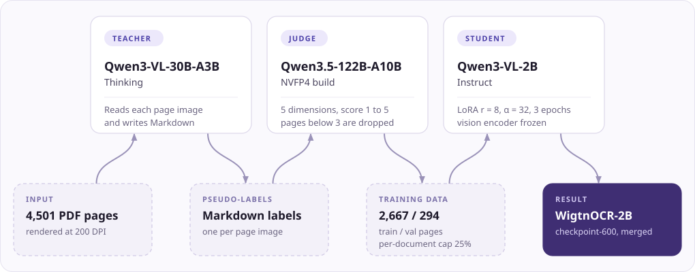

<div align="center">


<br>

[](requirements.txt)
[](LICENSE)
[](https://huggingface.co/Wigtn/Qwen3-VL-2B-WigtnOCR)
[](https://huggingface.co/datasets/Wigtn/KoGovDoc-Bench)

[English](README.md) | [한국어](README.ko.md) | [中文](README.cn.md)

</div>

# WigtnOCR

**Pseudo-Label Distillation for Structure-Preserving Document Parsing**

> Distill a 30B VLM's document parsing into a 2B model, then test whether its structured output helps retrieval on Korean government documents.

## News

- **2026-10-25** · RCPS, the follow-up study that uses WigtnOCR-2B as its production parser, is presented at **EMNLP 2026 (Industry Track)**: virtual presentation, Sunday 25 October, 12:30–14:00 CET, Virtual Session 1 ([program](https://2026.emnlp.org/program/)).
- **2026-08** · *Retrieval-Conditional Parsing Score (RCPS): Choosing Document Parsers by Retrieval, Not by Appearance* is accepted to the **EMNLP 2026 Industry Track**. Corresponding author: Hyeong-seob Kim. [Paper (camera-ready PDF)](https://github.com/wigtn/WigtnOCR-RADP/blob/main/output/pdf/EMNLP2026_Industry_384_camera_ready_final.pdf) · [Code](https://github.com/wigtn/WigtnOCR-RADP) · [Adapters](https://github.com/wigtn/RCPS-RADP-Adapters)
- **2026-03** · [WigtnOCR-2B](https://huggingface.co/Wigtn/Qwen3-VL-2B-WigtnOCR) and [KoGovDoc-Bench](https://huggingface.co/datasets/Wigtn/KoGovDoc-Bench) are released on Hugging Face.

> **One line of work in three repositories.**
> 1. **wigtnOCR-v1** (this repository): distills Qwen3-VL-30B into a 2B Qwen3-VL parser.
> 2. **[WigtnOCR-RADP](https://github.com/wigtn/WigtnOCR-RADP)**: the RCPS paper, which starts from that parser and selects parsers by retrieval.
> 3. **[RCPS-RADP-Adapters](https://github.com/wigtn/RCPS-RADP-Adapters)**: the nine LoRA adapters from the paper's parser-training study.

WigtnOCR distills document parsing from Qwen3-VL-30B (teacher) into Qwen3-VL-2B (student) with judge-filtered pseudo-labels and LoRA fine-tuning. On OmniDocBench the resulting **WigtnOCR-2B** matches or beats its 30B teacher on 3 of 5 metrics (Text NED, Table TEDS, Reading Order). In the v1 KoGovDoc retrieval evaluation it ranks first of six parsers in Hit@1, Hit@5 and MRR@10, with queries drawn from its own outputs (see below); on the RCPS paper's question–answer probe it is level with the 30B teacher.

---

## Built on Qwen

<div align="center">
<a href="https://github.com/QwenLM/Qwen3-VL"></a>
<br>
<sub>Banner from the <a href="https://qwen.ai/blog?id=qwen3-vl">Qwen3-VL announcement</a>.</sub>
</div>

Every model in the training pipeline is an openly released Qwen model. WigtnOCR is an independent project by WIGTN; it is not an official Qwen release.

<p align="center">

</p>

| Role | Model | How it is used |
|---|---|---|
| Teacher | Qwen3-VL-30B-A3B-Thinking | Writes Markdown for every page image. vLLM 0.13.0, 2 GPUs, temperature 0.1 |
| Judge | Qwen3.5-122B-A10B (NVFP4 build) | Scores the Markdown alone on five dimensions; pages below 3 are dropped ([rubric](docs/pseudo-label-judge.md)) |
| Student | Qwen3-VL-2B-Instruct | LoRA on the language model, vision encoder and merger frozen. ms-swift 4.0.1, DeepSpeed ZeRO-2 |
| Perplexity model, v1 BC/CS | Qwen2.5-1.5B-Instruct | Scores Boundary Clarity and Chunk Stickiness in the v1 KoGovDoc evaluation |
| Retriever in the RCPS paper | Qwen3-Embedding-8B | One of the three retrievers RCPS averages over, with BGE-M3 and multilingual-e5-large |
| Perplexity model, RCPS paper | Qwen3-VL-2B-Instruct | Scores Boundary Clarity in the RCPS paper |

The step-by-step recipe is in [docs/qwen3-vl-lora-guide.md](docs/qwen3-vl-lora-guide.md) ([한국어](docs/qwen3-vl-lora-guide.ko.md)).

---

## From WigtnOCR to RCPS

**What the v1 evaluation showed.** The fine-tuned model was compared with five other parsers on KoGovDoc (tables below). One result did not fit:

- MinerU had the best chunk-boundary scores of all six parsers (BC 0.735, CS 2.711).
- Yet it ranked fifth of six in retrieval (Hit@1 0.608).

A metric computed on the parser's output alone did not tell which parser the retriever would do best with.

**What the RCPS paper tested.** The EMNLP 2026 paper takes WigtnOCR-2B as its production parser, called *Prod* in the paper. It rebuilds the comparison on a frozen probe: 663 question–answer pairs over the 294 validation pages that were held out from WigtnOCR training. The paper reports:

- **Intrinsic scores can misrank parsers.**
  - Table-enabled MinerU-on has a higher Boundary Clarity than Prod (0.713 vs 0.610), but its Hit@1 is 42.6 points lower (0.123 vs 0.549).
  - Across the four complete outputs with defined BC, the Pearson correlation between BC and RCPS is r = −0.74.
- **RCPS ranks parsers by retrieval.** RCPS is mean reciprocal rank averaged over three retrievers and k ∈ {1, 5, 10}.
  - Five complete parser outputs span 0.137 to 0.584.
  - The 30B teacher (0.584) and Prod (0.583) are a near-tie at the top.
- **Coverage separates parser loss from chunker loss.**
  - For Prod, 20.2% of reference answers have no normalised exact match in the parser output before chunking.
  - No tested chunker splits more than 2.3%.
- **Selection matters more than tuning here.** On the same 294 pages, fine-tuning raised Prod's Hit@1 by 4.9 points over the 2B base. Choosing Prod over MinerU-on changes Hit@1 by 42.6 points.
- **Retrieval-aware training on top of Prod moved little.**
  - Two DPO checkpoints improve Hit@5 by only 0.95 and 1.15 points on an audited OHR-Bench subset.
  - A matched edit-distance control performs similarly.

The workflow the paper ends with is: select with RCPS, diagnose with coverage, and train the parser only if needed.

<div align="center">

</div>

The v1 tables below and the RCPS numbers above come from different protocols. They use different query sets, relevance rules and retrievers, so they are not directly comparable.

---

## Key Results (v1 evaluation)

### OmniDocBench: Distillation Effectiveness

<div align="center">

</div>

| Model | Text NED ↓ | Table TEDS ↑ | CDM F1 ↑ | Read Order ↓ | Skip % ↓ |
|-------|:----------:|:------------:|:--------:|:------------:|:--------:|
| Qwen3-VL-2B (Base) | 0.364 | 0.561 | 0.865 | 0.300 | 18.8% |
| **WigtnOCR-2B (Ours)** | **0.288** | **0.649** | **0.884** | **0.211** | **5.8%** |
| Qwen3-VL-30B (Teacher) | 0.289 | 0.523 | 0.939 | 0.227 | 5.5% |
| Marker | 0.218 | 0.586 | 0.863 | 0.165 | 0.4% |

**WigtnOCR-2B matches or exceeds its 30B teacher on 3 of 5 metrics: Text NED, Table TEDS and Reading Order.** The teacher stays ahead on CDM F1 (0.939 vs 0.884) and Skip % (5.5% vs 5.8%). Table TEDS surpasses the teacher by +12.6pp, and the skip rate drops from 18.8% (base) to 5.8%. Skip % is the share of the 1,355 pages with no usable output. The 30B row was evaluated with Qwen3-VL-30B-A3B-Instruct-FP8; the pseudo-labels came from the Thinking variant.

### KoGovDoc: Retrieval Performance

<div align="center">

</div>

| Model | Hit@1 ↑ | Hit@5 ↑ | MRR@10 ↑ | nDCG@10 ↑ |
|-------|:-------:|:-------:|:--------:|:---------:|
| **WigtnOCR-2B** | **0.739** | **0.855** | **0.788** | 0.437 |
| Qwen3-VL-30B | 0.716 | 0.839 | 0.771 | 0.411 |
| Marker | 0.711 | 0.853 | 0.771 | 0.412 |
| Qwen3-VL-2B | 0.709 | 0.814 | 0.756 | **0.444** |
| MinerU | 0.608 | 0.789 | 0.682 | 0.384 |
| PaddleOCR | 0.512 | 0.693 | 0.592 | 0.293 |

**WigtnOCR-2B ranks #1 in Hit@1, Hit@5, and MRR@10** across all 6 parsers; the 2B base leads nDCG@10. Compared to PaddleOCR (pure OCR), Hit@1 improves by +22.7pp.

**How this table was measured.** [`run_retrieval_eval.py`](scripts/eval_kogovdoc/run_retrieval_eval.py) takes up to 20 queries per document from the headings and first sentences of **WigtnOCR-2B's own outputs** (564 queries over 38 documents) and counts every chunk of the query's document as relevant. Queries drawn from one parser's output can favour that parser. The RCPS paper (above) instead uses 663 question–answer pairs whose answers occur verbatim on the reference pages, with page-level relevance; under that protocol the 30B teacher and WigtnOCR-2B are a near-tie.

### BC/CS: Chunk Quality Does Not Equal Search Quality

<div align="center">

</div>

| Model | BC ↑ | CS ↓ |
|-------|:----:|:----:|
| MinerU | **0.735** | **2.711** |
| WigtnOCR-2B | 0.706 | 2.859 |
| Qwen3-VL-30B | 0.714 | 3.164 |
| Marker | 0.683 | 3.206 |
| Qwen3-VL-2B | 0.678 | 3.446 |
| PaddleOCR | 0.654 | 3.420 |

MinerU leads BC/CS but ranks 5th in retrieval, so chunk boundary quality alone does not predict search performance. This is the result the RCPS paper follows up (see above).

---

## How It Works

### Distillation Pipeline

```
Stage 1: Pseudo GT Generation
    PDF pages → Qwen3-VL-30B-A3B-Thinking (teacher) → Structured Markdown
    4,501 pages across 49 documents (Korean + English)

Stage 2: Quality Validation
    GT Markdown → Qwen3.5-122B-A10B (judge, text-only) → Score 1–5
    74–75% pass rate, 5-dimension quality scoring

Stage 3: Training Data Preparation
    Quality filtering (score ≥ 3) + bias correction + train/val split
    2,667 train / 294 val pages

Stage 4: LoRA Fine-tuning
    Qwen3-VL-2B-Instruct + LoRA (rank=8, alpha=32) → WigtnOCR-2B
    ms-swift, DeepSpeed ZeRO-2, 3 epochs, released checkpoint: step 600
```

### Two-Step Evaluation (KoGovDoc)

```
Step 1: Does structured parsing produce better chunks?
    6 parsers × semantic chunking → BC/CS (perplexity-based, MoC ACL 2025)

Step 2: Do better chunks produce better retrieval?
    Chunks → BGE-M3 embedding → FAISS → Hit@K, MRR, nDCG
    Queries: headings and first sentences of WigtnOCR-2B outputs (564), document-level relevance
```

**Result:** Under these queries the structured VLM parsers retrieved best, but the parser with the best chunk scores (MinerU) ranked fifth. Chunk metrics alone did not predict retrieval.

---

## Reproducing the Results

The training and evaluation code that produced the tables above is in this repository: `training/`,
`evaluation/`, `scripts/` and `configs/`. Three environments are needed, because vLLM and ms-swift pin
different library versions:

```bash
python -m venv .venv-train && .venv-train/bin/pip install -r requirements.txt        # ms-swift 4.0.1, torch 2.9.1
python -m venv .venv-serve && .venv-serve/bin/pip install -r requirements-serve.txt  # vLLM 0.13.0
python -m venv .venv-eval  && .venv-eval/bin/pip install -r requirements-eval.txt    # evaluation code + RCPS reference implementation
```

Quickstart, one stage per script (start the matching `scripts/serve_*.sh` first):

```bash
bash scripts/01_pseudo_labels.sh      # teacher writes Markdown for every page
bash scripts/02_judge_filter.sh       # judge scores, filter, per-document cap, 90/10 split
bash scripts/03_train_lora.sh         # LoRA with configs/lora_qwen3vl2b_v1.yaml, merge checkpoint-600
bash scripts/04_eval_omnidocbench.sh  # OmniDocBench v1.5: Text NED, TEDS, Reading Order, CDM
bash scripts/05_eval_kogovdoc.sh      # KoGovDoc: Text NED; BC/CS and Hit@K/MRR/nDCG (v1); RCPS protocol
```

Each result below was checked for this release by rerunning the published code on the outputs the v1 run
stored. GPU steps (serving, training, model inference) were not rerun.

| Result | Code | Check |
|---|---|---|
| Training settings | [`configs/lora_qwen3vl2b_v1.yaml`](configs/lora_qwen3vl2b_v1.yaml) | The dry-run `swift sft` command matches the v1 run's `args.json` on every hyperparameter |
| Judge filter | [`docs/pseudo-label-judge.md`](docs/pseudo-label-judge.md) | The arXiv page count after filtering (646) reproduces from the v1 judge report |
| OmniDocBench: Text NED, TEDS, Reading Order, Skip % | `scripts/eval_omnidocbench/run_eval.py` | 0.288 / 0.649 / 0.211 / 79 pages, identical on the stored outputs |
| OmniDocBench: CDM F1 | `scripts/eval_omnidocbench/run_cdm.py` | Not rerun (needs a TeX toolchain) |
| KoGovDoc v1: Hit@K / MRR / nDCG | `scripts/eval_kogovdoc/run_retrieval_eval.py` | The same 564 queries reproduce. The scores do not reproduce exactly with a different BGE-M3 server, because semantic chunk boundaries move with the embeddings |
| KoGovDoc v1: BC/CS | `scripts/eval_kogovdoc/run_bccs_eval.py` | Not rerun (needs a Qwen2.5-1.5B-Instruct perplexity server) |
| RCPS protocol: retrieval | `scripts/eval_kogovdoc/run_rcps_eval.py` | BGE-M3 subset identical to the RCPS run (Hit@1 0.5445, MRR@10 0.5928) |
| RCPS protocol: Boundary Clarity | WigtnOCR-RADP `compute_parser_bc.py` | Mean BC 0.6100 over 1,161 boundaries; the paper reports 0.610 |

**Environment of the v1 run.**
- Hardware: 2 × NVIDIA RTX PRO 6000 Blackwell Server Edition (98 GB each), 128 GB RAM, CUDA 12.8.
- Software: PyTorch 2.9.1, Transformers 4.57.3, ms-swift 4.0.1, vLLM 0.13.0 (teacher and student; nightly for the judge).
- Seed 42 for judge sampling, the per-document cap, the train/val split and training (`seed`, `data_seed`).
- Training took 31 min 37 s for 1,002 steps at 47.25 GiB peak memory per GPU.

Not in this repository: the source PDFs of the 49 documents, the training split (`train.jsonl`), and the
`wigtnocr` inference library. The full walkthrough, with the evaluation-loss curve and the reason for
`checkpoint-600`, is in [docs/qwen3-vl-lora-guide.md](docs/qwen3-vl-lora-guide.md).

---

## Training Dataset

| Dataset | Documents | Pages | Language | Source |
|---------|:---------:|:-----:|:--------:|--------|
| **KoGovDoc** | 10 | 3,637 | Korean | Government publications |
| **ArXivPapers** | 39 | 864 | English | arXiv (cs.CL, cs.CV, cs.LG) |
| **Total** | 49 | 4,501 | Bilingual | |

GT generated by Qwen3-VL-30B-A3B-Thinking, validated by Qwen3.5-122B-A10B (text-only judge, 5-dimension scoring). After filtering and the per-document cap: 2,667 training and 294 validation pages. The validation split is public as [KoGovDoc-Bench](https://huggingface.co/datasets/Wigtn/KoGovDoc-Bench).

---

## Model

Model weights are available on Hugging Face:

- **[WigtnOCR-2B](https://huggingface.co/Wigtn/Qwen3-VL-2B-WigtnOCR)**: Qwen3-VL-2B-Instruct + LoRA, merged. It is `checkpoint-600` of the v1 run, the step with the lowest evaluation loss.

---

## Example Output

Comparison on a complex Korean government document page (kogov_001 p.9: survey tables, statistical charts and a mixed layout).

| | 30B Teacher | WigtnOCR-2B (Ours) |
|---|---|---|
| Charts | `[Figure: ...]` placeholder | Extracts data into tables |
| Content | 1,582 chars | **1,912 chars (+21%)** |
| Tables | 3 tables | **4 tables** (chart → table) |

<details>
<summary><b>PDF Original</b></summary>


</details>

<details>
<summary><b>30B Teacher Output (Qwen3-VL-30B)</b>: 1,582 chars</summary>

```markdown
- 지역 주민 의견 및 수요

## [군민 설문조사] 군민 478명 대상 설문조사로 도시문제 도출
- 군민 대상 설문조사 사항

| No. | 설문 항목 |
|-----|-----------|
| Q1 | 성별 / 연령 / 지역 / 불편사항 |
| Q2 | 안전 / 환경 / 에너지 / 교통 / 산업 / 행정 / 복지 / 문화 / 관광 / 농업 / 교육 |
| Q3 | 스마트도시 요소 / 지역 / 서비스 / 리빙랩 |

### - 군민 설문결과

[Figure: 보다 안전한 부여를 위해 개선해야 할 문제]
[Figure: 스마트도시 우선도입 서비스]

자료 : 부여군 스마트도시계획(2023)

## [농어업인 복지실태조사] 생활안전 개선을 위해 필요한 사항 설문결과

| 특성 | 도로안전시설 | 보행자길 정비 | 가로등 확충 | CCTV 설치 | 주민 방범 순찰 | 노후시설 | 안심 귀가 서비스 | 기타 |
|------|-------------|-------------|------------|----------|--------------|---------|----------------|------|
| 농어촌 | 10.1 | 21.0 | 23.1 | 25.7 | 8.1 | 8.2 | 3.4 | 0.3 |
| 읍 | 10.7 | 20.8 | 20.5 | 28.1 | 8.4 | 7.2 | 4.2 | 0.1 |
| 면 | 9.5 | 21.2 | 25.8 | 23.3 | 7.8 | 9.3 | 2.7 | 0.4 |
| 농어가 | 8.7 | 22.3 | 23.2 | 23.1 | 7.9 | 12.1 | 2.5 | 0.2 |
| 비농어가 | 10.6 | 20.5 | 23.1 | 26.6 | 8.2 | 6.9 | 3.7 | 0.3 |
| 30대 이하 | 14.6 | 16.5 | 27.6 | 25.2 | 6.4 | 5.8 | 3.6 | 0.2 |
| 40대 | 6.3 | 20.1 | 19.6 | 33.1 | 10.9 | 4.6 | 5.1 | 0.2 |
| 50대 | 10.8 | 19.4 | 23.0 | 27.2 | 6.8 | 8.4 | 4.1 | 0.3 |
| 60대 | 10.5 | 22.9 | 22.8 | 23.4 | 7.2 | 10.2 | 2.6 | 0.4 |
| 70대 이상 | 9.9 | 23.5 | 24.0 | 21.1 | 8.7 | 10.4 | 2.2 | 0.2 |

자료 : 농촌진흥청 2023 농어업인등에 대한 복지실태조사

| 구분 | 도시문제 | 주민 수요 | 수요 주민 |
|------|----------|-----------|-----------|
| 복지 | 독거노인 돌봄 | - 부여군 보건복지 분야 개선사항으로 지적 | 70대 남성 |
| 복지 | 독거노인 돌봄 | - 인공지능 돌봄서비스 시범 사용 희망 | 60대 여성 |
| 복지 | 시설노후화 | - 부여군 읍면 경로당 내 시설 노후화 | 80대 남성 |
| 복지 | 여가 콘텐츠 부족 | - 경로당 내 여가 콘텐츠 부족 | 60대 여성 |
| 안전 | 안전 인프라 부족 | - 부여시장 근교 노인 보행자 교통사고 위험 높음 | 60대 남성 |
| 관광 | 관광 콘텐츠 부족 | - 수년 동안 업데이트되지 않은 박물관 내 콘텐츠 | 50대 남성 |
```

</details>

<details>
<summary><b>WigtnOCR-2B Output (Ours)</b>: 1,912 chars</summary>

```markdown
- 지역 주민 의견 및 수요

[균민 설문조사] 균민 478명 대상 설문조사로 도시문제 도출
- 균민 대상 설문조사 사항

| No. | 설문 항목 |
| --- | --- |
| Q1 | 성별 / 연령 / 지역 / 불편사항 |
| Q2 | 안전 / 환경 / 에너지 / 교통 / 산업 / 행정 / 보건 / 복지 / 문화 / 관광 / 농업 / 교육 |
| Q3 | 스마트도시 요소 / 지역 / 서비스 / 리빙랩 |

- 균민 설문결과

| 보다 안전한 부여를 위해 개선해야 할 문제 | 스마트도시 우선도입 서비스 |
| --- | --- |
| 시설 노후화 | 34.1% |
| 교통사고 다발구간 | 13.7% |
| 자연재해감시 | 12.8% |
| 심야시간 범죄 | 10.0% |
| 통학 안전 | 9.3% |
| 인재 | 8.2% |
| 재난 예경보 | 8.7% |
| 기타 | 3.4% |
| 스마트 보건/의료/복지 | 17.4% |
| 스마트 교통 | 15.7% |
| 스마트 환경/에너지/수자원 | 10.5% |
| 스마트 문화/관광/스포츠 | 10.1% |
| 스마트 근로/고용 | 9.9% |
| 스마트 행정 | 8.9% |
| 스마트 교육 | 7.6% |
| 스마트 방법/방재 | 6.4% |
| 스마트 시설물관리 | 4.5% |
| 스마트 주거 | 3.2% |
| 스마트 물류 | 2.8% |
| 기타 | 2.9% |

자료 : 부여군 스마트도시계획(2023)

[농어업인 복지실례조사] 생활안전 개선을 위해 필요한 사항 설문결과

| 특성 | 도로안전시설 | 보행자길 정비 | 가로등 확충 | CCTV 설치 | 주민 방법순찰 | 노후시설 | 안심 귀가 서비스 | 기타 |
| --- | --- | --- | --- | --- | --- | --- | --- | --- |
| 농어촌 | 10.1 | 21.0 | 23.1 | 25.7 | 8.1 | 8.2 | 3.4 | 0.3 |
| 읍 | 10.7 | 20.8 | 20.5 | 28.1 | 8.4 | 7.2 | 4.2 | 0.1 |
| 면 | 9.5 | 21.2 | 25.8 | 23.3 | 7.8 | 9.3 | 2.7 | 0.4 |
| 농어가 | 8.7 | 22.3 | 23.2 | 23.1 | 7.9 | 12.1 | 2.5 | 0.2 |
| 비농어가 | 10.6 | 20.5 | 23.1 | 26.6 | 8.2 | 6.9 | 3.7 | 0.3 |
| 30대 이하 | 14.6 | 16.5 | 27.6 | 25.2 | 6.4 | 5.8 | 3.6 | 0.2 |
| 40대 | 6.3 | 20.1 | 19.6 | 33.1 | 10.9 | 4.6 | 5.1 | 0.2 |
| 50대 | 10.8 | 19.4 | 23.0 | 27.2 | 6.8 | 8.4 | 4.1 | 0.3 |
| 60대 | 10.5 | 22.9 | 22.8 | 23.4 | 7.2 | 10.2 | 2.6 | 0.4 |
| 70대 이상 | 9.9 | 23.5 | 24.0 | 21.1 | 8.7 | 10.4 | 2.2 | 0.2 |

자료 : 농촌진흥청 2023 농어업인등에 대한 복지실례조사

| 구분 | 도시문제 | 주민 수요 | 수요 주민 |
| --- | --- | --- | --- |
| 복지 | 독거노인 돌봄 | - 부여군 보건복지 분야 개선사항으로 지적 | 70대 남성 |
| 복지 | 독거노인 돌봄 | - 인공지능 돌봄서비스 시범 사용 호평 | 60대 여성 |
| 복지 | 시설노후화 | - 부여군 읍면 경로당 내 시설 노후화 | 80대 남성 |
| 복지 | 여가 콘텐츠 부족 | - 경로당 내 여가 콘텐츠 부족 | 60대 여성 |
| 안전 | 안전 인프라 부족 | - 부여시장 근교 노인 보행자 교통사고 위험 높음 | 60대 남성 |
| 관광 | 관광 콘텐츠 부족 | - 수년 동안 업데이트되지 않은 박물관 내 콘텐츠 | 50대 남성 |
```

</details>

> **Key difference:** The 30B teacher replaces charts with `[Figure: ...]` placeholders, while WigtnOCR-2B extracts the actual data from charts into structured markdown tables, producing 21% more content from the same page.

---

## References

- [Qwen3-VL](https://huggingface.co/Qwen/Qwen3-VL-2B-Instruct): base VLM family (teacher and student)
- [Qwen3.5-122B-A10B](https://huggingface.co/Qwen/Qwen3.5-122B-A10B): judge model
- [ms-swift](https://github.com/modelscope/ms-swift): ModelScope fine-tuning framework, used for LoRA training
- [MoC](https://arxiv.org/abs/2503.09600): BC/CS chunk quality metrics (ACL 2025)
- [OmniDocBench](https://github.com/opendatalab/OmniDocBench): document parsing benchmark (CVPR 2025)
- [vLLM](https://github.com/vllm-project/vllm): VLM serving engine
- [BGE-M3](https://huggingface.co/BAAI/bge-m3): multilingual embedding model
- [PaddleOCR](https://github.com/PaddlePaddle/PaddleOCR): OCR baseline (via RapidOCR)
- [Marker](https://github.com/VikParuchuri/marker): PDF-to-markdown converter
- [MinerU](https://github.com/opendatalab/MinerU): PDF parsing tool

---

## License

Apache License 2.0

## Citation

```bibtex
@software{wigtnocr2026,
  title   = {WigtnOCR: Pseudo-Label Distillation for Structure-Preserving Document Parsing},
  author  = {Kim, Hyeongseob},
  year    = {2026},
  url     = {https://github.com/wigtn/wigtnOCR-v1}
}

@inproceedings{son2026rcps,
  title     = {Retrieval-Conditional Parsing Score (RCPS): Choosing Document Parsers by Retrieval, Not by Appearance},
  author    = {Son, Sang-Woo and Kim, Hyeong-seob and Kim, Hyeonsang and Cho, Hyun-woo and Kim, Jinmo},
  booktitle = {Proceedings of EMNLP 2026 (Industry Track)},
  year      = {2026},
  note      = {Accepted}
}
```

---

## 🏢 About WIGTN Crew

This project is built and maintained by **[WIGTN Crew](https://wigtn.com)**,
an AI-native open-source research crew based in Korea.
We build practical, domain-specialized AI tools. Fast prototyping, strong engineering, shipping real things.

| | |
|---|---|
| 🌐 Website | [wigtn.com](https://wigtn.com) |
| 🐙 GitHub | [github.com/wigtn](https://github.com/wigtn) |
| 🤗 HuggingFace | [huggingface.co/Wigtn](https://huggingface.co/Wigtn) |
| 📦 NPM | [npmjs.com/org/wigtn](https://www.npmjs.com/org/wigtn) |

### 🔬 Our Projects

| Project | Description | Status |
|---------|-------------|--------|
| [WigtnOCR](https://huggingface.co/Wigtn/Qwen3-VL-2B-WigtnOCR) | VLM-based Korean government document parser | Research |
| [WIGVO](https://wigtn.com) | Real-time PSTN voice translation (Korean↔English) | Research |
| [Claude Code Plugin](https://github.com/wigtn/wigtn-plugins) | Multi-agent parallel execution ecosystem | Open Source |

> Results speak louder than résumés.
